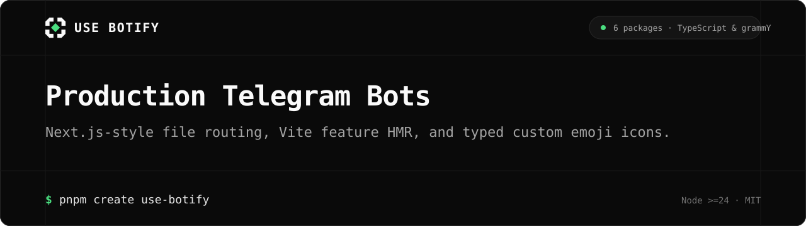
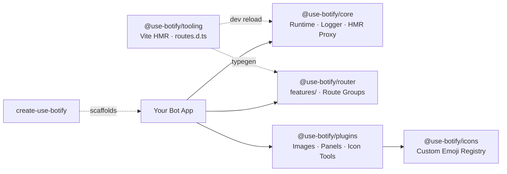

<div align="center">
  <a href="https://github.com/use-botify/use-botify-starter">
    
  </a>

  <br />
  <br />

  <p>
    <a href="https://github.com/use-botify/use-botify-starter/actions/workflows/ci.yml">
      
    </a>
    <a href="https://www.npmjs.com/package/create-use-botify">
      
    </a>
    <a href="https://www.npmjs.com/package/@use-botify/icons">
      
    </a>
    =24.0.0" />
    <a href="./LICENSE">
      
    </a>
  </p>

  <p>
    <a href="#quick-start">Quick Start</a> ·
    <a href="#ecosystem">Ecosystem</a> ·
    <a href="#architecture">Architecture</a> ·
    <a href="./apps/web/content/docs">Docs</a> ·
    <a href="./CONTRIBUTING.md">Contributing</a>
  </p>
</div>

---

**Use Botify** is a modular TypeScript framework and CLI scaffolder for building Next.js-style [grammY](https://grammy.dev) Telegram bots — complete with file-based `features/` routing, zero-restart Vite HMR, typed custom Telegram emoji icons, and strict Zod environment validation.

## Quick Start

Scaffold a complete bot with your preferred package manager:

```bash
pnpm create use-botify
```

```bash
npx create-use-botify@latest
```

```bash
bun create use-botify
```

Or skip interactive prompts and scaffold with defaults:

```bash
pnpm create use-botify my-bot --yes
```

> **Prerequisite:** Node.js `>=24.0.0` (uses native ESM and `process.loadEnvFile()`).

## Highlights

- **File-Based Routing (`@use-botify/router`)** — Drop `command.ts` and `*.callback.ts` inside `features/`, organize access tiers with `(admin)` / `(developer)` route groups, and match dynamic `[param]` callbacks.
- **Zero-Restart Feature HMR (`@use-botify/tooling`)** — Edit feature handlers live through Vite SSR while Telegram long polling, loggers, and database pools stay connected.
- **Typed Custom Emojis (`@use-botify/icons`)** — Strongly typed `<tg-emoji>` HTML rendering and inline keyboard button builders backed by an atomic JSON + TypeScript registry.
- **Modular Plugins (`@use-botify/plugins`)** — Magic-byte validated image `file_id` caching, reusable HTML UI panels, and interactive `/add_icon`, `/list_icons`, `/remove_icon` commands.
- **Strict Defaults** — Pre-wired with TypeScript, Biome, Zod env parsing, and graceful `SIGINT`/`SIGTERM` shutdown.

## Ecosystem

| Package                                                                    | Version | Role                                                                | Source                                               |
| :------------------------------------------------------------------------- | :-----: | :------------------------------------------------------------------ | :--------------------------------------------------- |
| [`create-use-botify`](https://www.npmjs.com/package/create-use-botify)     | `0.1.0` | Interactive CLI scaffolder & programmatic template engine           | [`apps/create-use-botify`](./apps/create-use-botify) |
| [`@use-botify/core`](https://www.npmjs.com/package/@use-botify/core)       | `0.1.0` | Bot runtime, structured logger, graceful shutdown & HMR dispatcher  | [`packages/core`](./packages/core)                   |
| [`@use-botify/router`](https://www.npmjs.com/package/@use-botify/router)   | `0.1.0` | File-based `features/` router, `(tier)` route groups & menu sync    | [`packages/router`](./packages/router)               |
| [`@use-botify/tooling`](https://www.npmjs.com/package/@use-botify/tooling) | `0.1.0` | Vite SSR feature HMR, `routes.d.ts` typegen & icon registry codegen | [`packages/tooling`](./packages/tooling)             |
| [`@use-botify/plugins`](https://www.npmjs.com/package/@use-botify/plugins) | `0.1.0` | Image `file_id` caching, HTML UI panels & custom emoji tools        | [`packages/plugins`](./packages/plugins)             |
| [`@use-botify/icons`](https://www.npmjs.com/package/@use-botify/icons)     | `1.0.0` | Typed custom Telegram emoji registry & inline button builders       | [`packages/icons`](./packages/icons)                 |

## Architecture



## Monorepo Development

```bash
git clone [https://github.com/use-botify/use-botify-starter.git](https://github.com/use-botify/use-botify-starter.git)
cd use-botify-starter
pnpm install
```

| Command                 | Description                                        |
| :---------------------- | :------------------------------------------------- |
| `pnpm dev:web`          | Start `apps/web` (landing page + Fumadocs `/docs`) |
| `pnpm test`             | Run Vitest unit tests across all packages          |
| `pnpm check`            | Run Biome lint & formatting verification           |
| `pnpm check:fix`        | Auto-fix Biome lint & formatting issues            |
| `pnpm script:check:all` | Full Biome + TypeScript monorepo check             |

## Contributing & Security

- Read [CONTRIBUTING.md](./CONTRIBUTING.md) before opening a pull request.
- Follow our [Code of Conduct](./CODE_OF_CONDUCT.md).
- Report security issues privately via [SECURITY.md](./SECURITY.md).

## License

[MIT](./LICENSE) © 2026 Use Botify ([Sahil Kumar](https://sahilkumardev.com))
